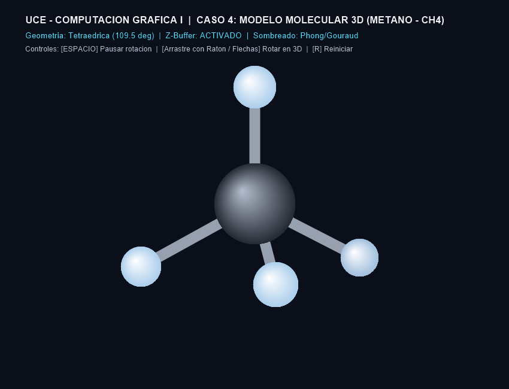

# Practica Integradora: Computacion Grafica I

**Universidad Central del Este (UCE) - Recinto Punta Cana**  
**Asignatura:** Computacion Grafica I (ISW-411)  
**Profesor:** Ing. Richard A. Jimenez Rijo  
**Estudiante:** Julian Vazquez  
**Matricula:** 2023-0715  
**Fecha:** Noviembre 2026  

---

## Descripcion

Este repositorio contiene las soluciones en C con OpenGL y GLUT para la Practica Integradora del Segundo Parcial:

1. **Caso 1:** Panel de ocupacion hotelera con grafico de barras y semaforo de color.
2. **Caso 2:** Simulacion de particulas de gas en 2D rebotando en un contenedor cerrado.
3. **Caso 3:** Brazo robotico articulado con transformaciones jerarquicas y control por teclado.
4. **Caso 4:** Visualizador molecular en 3D con Z-Buffer, proyeccion en perspectiva y rotacion continua.

---

## Estructura del Proyecto

```text
practica-integradora-cg1/
├── caso1.c                  <- Codigo fuente del Caso 1
├── caso2.c                  <- Codigo fuente del Caso 2
├── caso3.c                  <- Codigo fuente del Caso 3
├── caso4.c                  <- Codigo fuente del Caso 4
├── capturas/                <- Capturas de los programas funcionando
│   ├── caso1.png
│   ├── caso2.png
│   ├── caso3.png
│   └── caso4.png
├── .gitignore
└── README.md
```

---

## Detalle de Cada Caso

### Caso 1: Panel de Ocupacion Hotelera
* **Archivo:** `caso1.c`
* **Descripcion:** Muestra la ocupacion semanal de un hotel en un grafico de barras.
* **Datos graficados:** Lunes 65%, Martes 72%, Miercoles 80%, Jueves 95%, Viernes 88%, Sabado 60%, Domingo 55%.
* **Conceptos usados:**
  * Coordenadas 2D con `gluOrtho2D`.
  * Ejes y lineas guia con `GL_LINES`.
  * Barras con `GL_QUADS`.
  * Semaforo condicional antes de dibujar cada barra: Verde (< 70%), Ambar (70% - 89%), Rojo (>= 90%).
  * Etiquetas de texto con `glutBitmapCharacter`.


---

### Caso 2: Particulas de Gas en Contenedor
* **Archivo:** `caso2.c`
* **Descripcion:** 20 particulas rebotando de forma elastica dentro de una caja rectangular cerrada.
* **Conceptos usados:**
  * Dibujo de circulos usando `GL_TRIANGLE_FAN`.
  * Bucle de animacion continuo a 60 FPS con `glutTimerFunc`.
  * Deteccion de colisiones en las cuatro paredes invirtiendo la velocidad (`vx = -vx`, `vy = -vy`) y tomando en cuenta el radio para que rebote el borde.
  * Color de particulas segun su rapidez.


---

### Caso 3: Brazo Robotico Articulado
* **Archivo:** `caso3.c`
* **Descripcion:** Brazo mecanico de dos segmentos montado sobre una base fija, donde el antebrazo hereda la rotacion del brazo.
* **Conceptos usados:**
  * Jerarquia con `glPushMatrix` y `glPopMatrix`.
  * Rotacion y traslacion relativa con `glRotatef` y `glTranslatef`.
  * Segmentos rectangulares con `GL_QUADS` y articulaciones circulares con `GL_TRIANGLE_FAN`.
  * Controles por teclado: Teclas `A` y `D` para mover el hombro, teclas `W` y `S` para mover el codo.


---

### Caso 4: Modelo Molecular 3D
* **Archivo:** `caso4.c`
* **Descripcion:** Visualizador 3D de una molecula con un atomo central y cuatro satelites en disposicion tetraedrica.
* **Conceptos usados:**
  * Proyeccion en perspectiva con `gluPerspective`.
  * Camara colocada con `gluLookAt` mirando hacia el centro.
  * Z-Buffer activo con `GLUT_DEPTH`, `glEnable(GL_DEPTH_TEST)` y limpieza de profundidad.
  * Esferas 3D con `glutSolidSphere`.
  * Bloques independientes con `glPushMatrix` / `glPopMatrix` para cada atomo.
  * Iluminacion basica con `GL_LIGHTING` y rotacion continua animada con `glutTimerFunc`.



---

## Como Compilar y Ejecutar

### Con GCC / MinGW en Windows:
```bash
# Caso 1
gcc caso1.c -o caso1.exe -lfreeglut -lopengl32 -lglu32
./caso1.exe

# Caso 2
gcc caso2.c -o caso2.exe -lfreeglut -lopengl32 -lglu32
./caso2.exe

# Caso 3
gcc caso3.c -o caso3.exe -lfreeglut -lopengl32 -lglu32
./caso3.exe

# Caso 4
gcc caso4.c -o caso4.exe -lfreeglut -lopengl32 -lglu32
./caso4.exe
```

### En Code::Blocks o Dev-C++:
1. Crear proyecto GLUT o consola.
2. Agregar el archivo `.c` deseado.
3. En Linker Settings agregar: `-lfreeglut -lopengl32 -lglu32`.
4. Compilar y correr (`F9`).

### En Linux (Ubuntu / Debian):
```bash
sudo apt-get install freeglut3-dev
gcc caso1.c -o caso1 -lGL -lGLU -lglut && ./caso1
gcc caso2.c -o caso2 -lGL -lGLU -lglut && ./caso2
gcc caso3.c -o caso3 -lGL -lGLU -lglut && ./caso3
gcc caso4.c -o caso4 -lGL -lGLU -lglut && ./caso4
```
