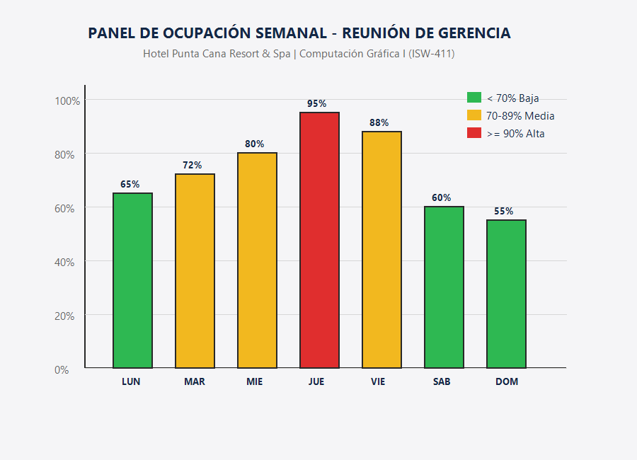
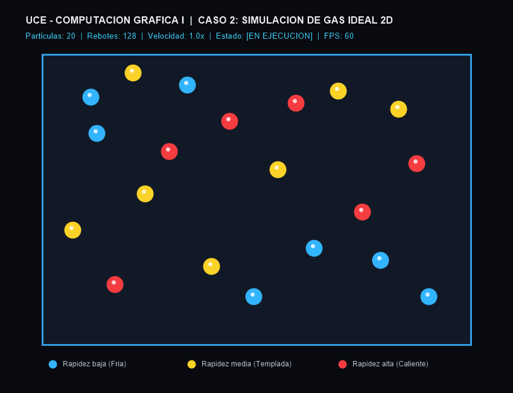
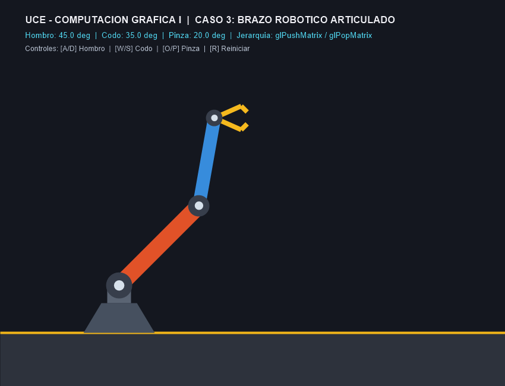

# Práctica Integradora: La Computación Gráfica más allá de los videojuegos

**Universidad Central del Este (UCE) · Recinto Punta Cana**  
**Facultad de Ingenierías y Tecnologías**  
**Asignatura:** Computación Gráfica I (ISW-411)  
**Profesor:** Ing. Richard A. Jiménez Rijo  
**Estudiante:** Julián Vázquez  
**Matrícula:** 2023-0715  
**Fecha:** Noviembre 2026  

---

## 1. Descripción del Proyecto

Este repositorio contiene las soluciones completas en **lenguaje C con OpenGL y GLUT** correspondientes a la **Práctica Integradora del Segundo Parcial**. El objetivo central es demostrar la aplicación práctica de los principios de computación gráfica en dominios de ingeniería, ciencia y analítica de datos:
1. **Analítica de Datos:** Visualización y dashboards gerenciales con semáforos condicionales en 2D.
2. **Simulación Física:** Dinámica molecular y comportamiento de gases ideales con rebotes elásticos en recipientes cerrados.
3. **Diseño Mecánico y CAD:** Cinemática directa y transformaciones jerárquicas de un brazo robótico articulado con efector final.
4. **Química Computacional:** Visualizador tridimensional de geometrías moleculares con proyección en perspectiva, cámara orbital e iluminación sintética con Z-Buffer.

---

## 2. Estructura del Repositorio

```text
practica-integradora-cg1/
├── caso1.c                  ← CASO 1: Panel de ocupación hotelera (Visualización de datos)
├── caso2.c                  ← CASO 2: Simulación de partículas de gas (Física y modelado)
├── caso3.c                  ← CASO 3: Brazo robótico articulado (Jerarquías y cinemática)
├── caso4.c                  ← CASO 4: Modelo molecular 3D (Perspectiva, Z-Buffer y cámara)
├── capturas/                ← Evidencias visuales de los programas en ejecución
│   ├── caso1.png
│   ├── caso2.png
│   ├── caso3.png
│   └── caso4.png
├── .gitignore               ← Exclusión de binarios (.exe, .o, .obj)
└── README.md                ← Documentación técnica e instrucciones de compilación
```

---

## 3. Detalle de los Casos Implementados

### CASO 1 · Visualización de Datos — Panel de Ocupación Hotelera
* **Archivo:** `caso1.c`
* **Dominio:** Analítica de datos y dashboards gerenciales.
* **Descripción:** Visor gráfico para el departamento de TI que proyecta la ocupación semanal de un hotel mediante un gráfico de barras coloreadas según un semáforo de ocupación.
* **Datos Representados:**
  * Lunes: 65% (Baja · Verde)
  * Martes: 72% (Media · Ámbar)
  * Miércoles: 80% (Media · Ámbar)
  * Jueves: 95% (Alta · Rojo)
  * Viernes: 88% (Media · Ámbar)
  * Sábado: 60% (Baja · Verde)
  * Domingo: 55% (Baja · Verde)
* **Conceptos Técnicos:**
  * Ventana de proyección ortogonal mediante `gluOrtho2D(-12.0, 76.0, -15.0, 125.0)`.
  * Ejes coordenados y líneas guía trazados con `GL_LINES`.
  * Barras rectangulares construidas mediante `GL_QUADS`.
  * Máquina de estados con color condicional: Verde (`<70%`), Ámbar (`70-89%`), Rojo (`>=90%`).
  * Rotulación bitmap tipográfica con `glRasterPos2f` y `glutBitmapCharacter`.



---

### CASO 2 · Simulación Científica — Partículas de un Gas en Contenedor
* **Archivo:** `caso2.c`
* **Dominio:** Simulación física y cinética de gases.
* **Descripción:** Animación de 20 partículas en movimiento browniano/lineal confinadas dentro de un contenedor rectangular hermético. Cada partícula rebota elásticamente en las 4 paredes conservando su rapidez.
* **Conceptos Técnicos:**
  * Primitiva `GL_TRIANGLE_FAN` para dibujar partículas circulares suaves.
  * Ciclo de animación a ~60 FPS implementado con `glutTimerFunc(16, actualizar, 0)`.
  * Detección de colisiones contra bordes tomando en cuenta el radio ($r$) de la partícula para que el impacto ocurra en el perímetro y no en el centro geométrico.
  * Mapeo de color según energía cinética / rapidez escalar (azul = fría, amarillo = media, rojo = caliente).
* **Controles:**
  * `ESPACIO`: Pausar / reanudar simulación.
  * `+` / `-`: Aumentar o disminuir velocidad / temperatura.
  * `R`: Reinicializar posiciones y velocidades aleatorias.



---

### CASO 3 · Diseño e Ingeniería — Brazo Robótico Articulado 2D
* **Archivo:** `caso3.c`
* **Dominio:** Robótica industrial, CAD y transformaciones jerárquicas.
* **Descripción:** Simulador cinemático de un brazo robótico de dos segmentos (brazo y antebrazo) montado sobre una base fija, junto con un efector final de pinza mecánica de dos dedos (reto opcional).
* **Conceptos Técnicos:**
  * Uso riguroso de la pila de matrices con `glPushMatrix()` y `glPopMatrix()`.
  * El antebrazo se articula en el extremo del brazo y hereda automáticamente su traslación y rotación.
  * Segmentos rectangulares modelados con `GL_QUADS` y articulaciones circulares con remaches metálicos mediante `GL_TRIANGLE_FAN`.
* **Controles:**
  * `A` / `D` (o Flechas Izq/Der): Rotar articulación del hombro (brazo).
  * `W` / `S` (o Flechas Arr/Aba): Rotar articulación del codo (antebrazo).
  * `O` / `P`: Abrir / cerrar pinza mecánica.
  * `R`: Restaurar postura neutra.



---

### CASO 4 · Visualización Científica 3D — Modelo Molecular de Metano ($CH_4$)
* **Archivo:** `caso4.c`
* **Dominio:** Química computacional y visores tridimensionales.
* **Descripción:** Visor 3D interactivo de una molécula de Metano ($CH_4$), consistente en un átomo central de Carbono y cuatro átomos de Hidrógeno orientados con simetría tetraédrica perfecta ($109.5^\circ$), unidos por enlaces covalentes cilíndricos.
* **Conceptos Técnicos:**
  * Proyección en perspectiva real con `gluPerspective(45.0, aspecto, 1.0, 50.0)`.
  * Posicionamiento de cámara sintética orbital con `gluLookAt()`.
  * Activación completa del Z-Buffer (`GLUT_DEPTH`, `glEnable(GL_DEPTH_TEST)` y `glClear(GL_COLOR_BUFFER_BIT | GL_DEPTH_BUFFER_BIT)`).
  * Esferas paramétricas con `glutSolidSphere()`.
  * Modelo de iluminación fotorealista Phong/Gouraud (`GL_LIGHTING`, `GL_LIGHT0`) con brillos especulares.
  * Rotación continua suave automática a ~60 FPS mediante `glutTimerFunc()`.
* **Controles:**
  * `ESPACIO`: Pausar / reanudar rotación automática.
  * `Arrastre con Ratón` / `Flechas`: Rotación libre e inclinación en 3D.
  * `R`: Reiniciar orientación de la cámara.


---

## 4. Instrucciones de Compilación y Ejecución

### Opción A: Compilación por Terminal (MinGW / GCC en Windows)
Para compilar cualquiera de los 4 casos:
```bash
# Caso 1 (Dashboard Hotelero)
gcc caso1.c -o caso1.exe -lfreeglut -lopengl32 -lglu32
./caso1.exe

# Caso 2 (Particulas de Gas 2D)
gcc caso2.c -o caso2.exe -lfreeglut -lopengl32 -lglu32
./caso2.exe

# Caso 3 (Brazo Robotico Articulado)
gcc caso3.c -o caso3.exe -lfreeglut -lopengl32 -lglu32
./caso3.exe

# Caso 4 (Modelo Molecular 3D)
gcc caso4.c -o caso4.exe -lfreeglut -lopengl32 -lglu32
./caso4.exe
```

### Opción B: Code::Blocks / Dev-C++ (Windows)
1. Crear un nuevo proyecto de tipo **GLUT Project** o **Console Application**.
2. Agregar el archivo fuente correspondiente (`caso1.c`, `caso2.c`, `caso3.c` o `caso4.c`).
3. En las opciones del enlazador (**Project -> Build Options -> Linker Settings**), agregar:
   * `-lfreeglut` (o `-lglut32`)
   * `-lopengl32`
   * `-lglu32`
4. Presionar **F9** (*Build and Run*).

### Opción C: Linux (Ubuntu / Debian)
```bash
sudo apt-get install freeglut3-dev
gcc caso1.c -o caso1 -lGL -lGLU -lglut && ./caso1
gcc caso2.c -o caso2 -lGL -lGLU -lglut && ./caso2
gcc caso3.c -o caso3 -lGL -lGLU -lglut && ./caso3
gcc caso4.c -o caso4 -lGL -lGLU -lglut && ./caso4
```

---

## 5. Conclusiones y Aprendizaje

Esta práctica integradora evidencia que las herramientas fundamentales de la computación gráfica —sistemas coordenados, primitivas, transformaciones afines, pilas matriciales, iluminación sintética y bucles de animación temporal— son transversales a múltiples disciplinas de la ingeniería. No se limitan a los videojuegos, sino que constituyen la base de los modernos sistemas de telemetría industrial, simuladores físicos, software de robótica y herramientas de análisis molecular.
